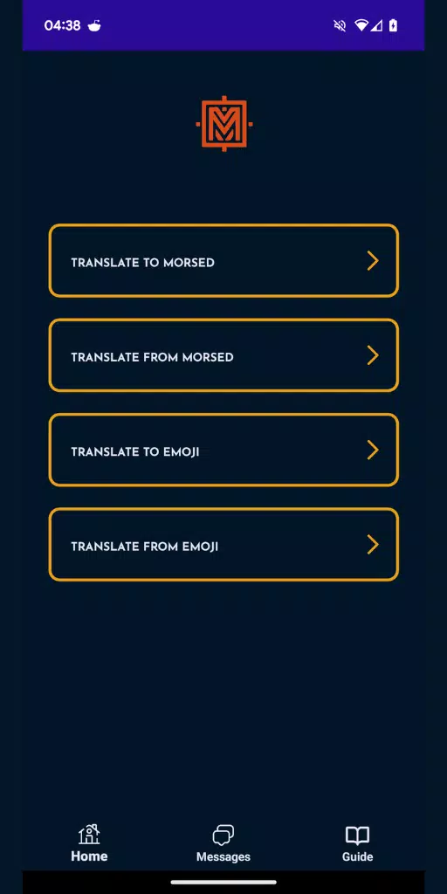
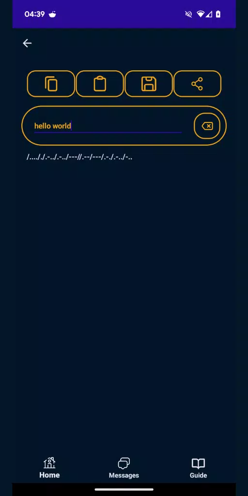
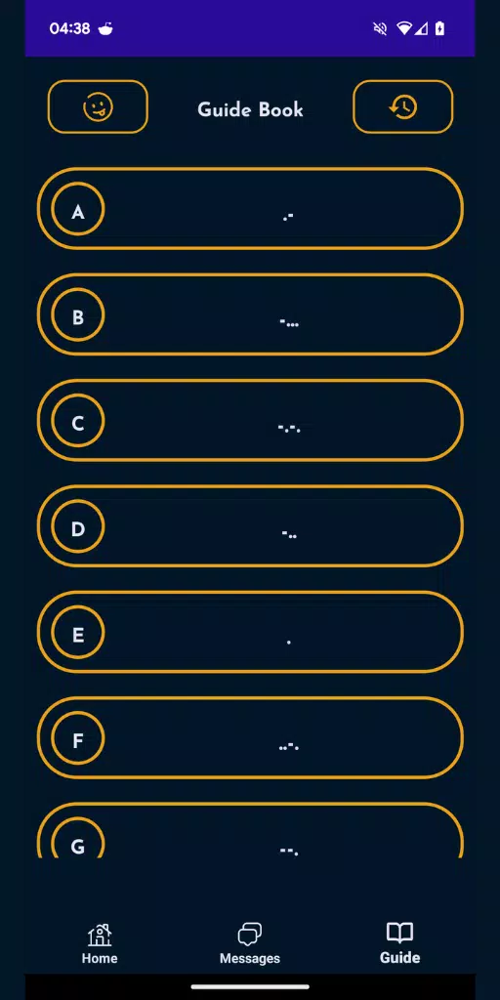
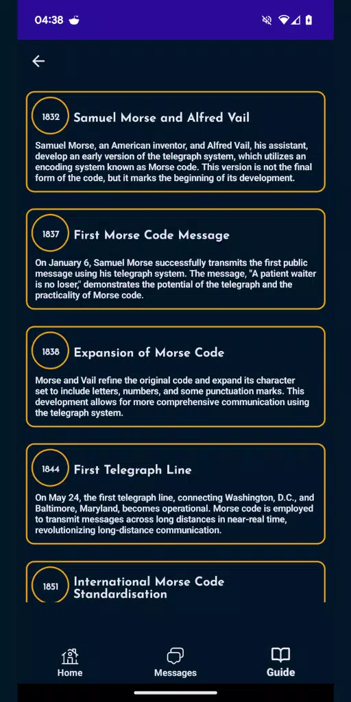

## Rebuilding Morsed: A Simple, Fun Morse Code Translator

Alongside productivity tools like **SLAPP!**, another early project from my app archive was **Morsed**, a lightweight Morse code translation app designed to make encoding and decoding messages effortless, approachable, and fun.

I am currently planning and preparing to bring Morsed back online with a modern implementation while keeping its original focus on simple, immediate translation.

### What Morsed Was All About

Morse code has always had a timeless appeal, whether you are learning it out of curiosity or practicing for more practical communication. With Morsed, the goal was to strip away any friction so anyone could jump straight in and start translating within seconds.

Instead of burying features behind cluttered menus, Morsed focused on a clean, intuitive interface where converting plain text to dots and dashes, or decoding Morse back into readable text, happened immediately.

### Key Features

- **Two-Way Instant Translation:** Seamlessly translate standard text into Morse code and decode Morse code messages back into plain text.
- **Emoji Encoding:** Beyond classic dots and dashes, Morsed included a playful twist: the ability to convert Morse code into popular emojis to represent letters and symbols, making secret messages fun to share with friends.
- **Beginner-Friendly & Straightforward:** Designed with a simple, distraction-free layout so both newcomers learning the alphabet and experienced Morse users could use it right away.

### What It Taught Me

Building Morsed was a great reminder that small, focused utility apps can still bring a lot of joy when the user experience is simple and immediate. Taking a classic communication format and adding a creative, playful spin, like emoji translation, showed how thoughtful little details can make an everyday tool far more engaging.

Morsed remains a fun chapter in my journey of building accessible, human-centered communication tools, and work is underway to bring it back.

### App Store Screenshots

  

    
  

  

    
  

  

    
  

  

    
  

