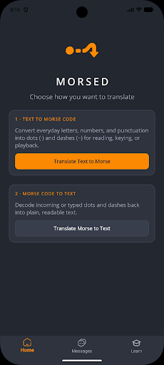
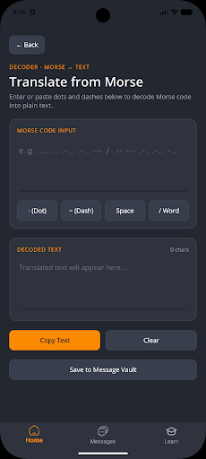
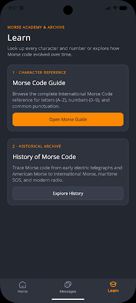
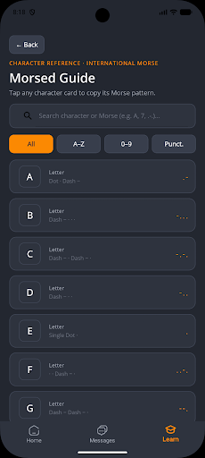

## Bringing Morsed Back on .NET 11 MAUI

Alongside productivity tools like **SLAPP!**, **Morsed** started out as an early project from my app archive—a straightforward Morse code utility built for quick encoding and decoding.

After moving it over to **.NET 11 MAUI** with a refreshed dark/slate interface and Signal Orange accents, it is now back live in the stores, with plenty of ongoing polish and upcoming improvements on the roadmap.

### What Morsed Was All About

Morse code has a lasting appeal whether you are picking up the basics out of curiosity or practicing dot-and-dash patterns. The focus with Morsed has always been keeping the interface uncluttered so you can translate, look up characters, and explore without friction.

### What's Included

- **Two-Way Translation:** Convert plain text into International Morse code or decode dots and dashes back into readable text using quick-tap input keys, character counts, copy, and clear actions.
- **Saved Messages Vault:** Keep translations handy in a dedicated list with tap-to-view and swipe-to-delete.
- **Morse Code Guidebook:** Browse letters, numbers, and punctuation with search and category filtering, and tap any entry to copy its code.
- **Morse Code History:** Read through the people, milestones, and practical uses behind Morse code, filtered by topic.

### What's Next

Getting the .NET 11 MAUI build back into the stores was the main milestone, and there is still plenty on the list—including tighter MVVM structure, persistent vault storage, sensory playback features like haptics and read-out, and expanded test coverage.

### App Store Screenshots

  

    
  

  

    
  

  

    
  

  

    
  

