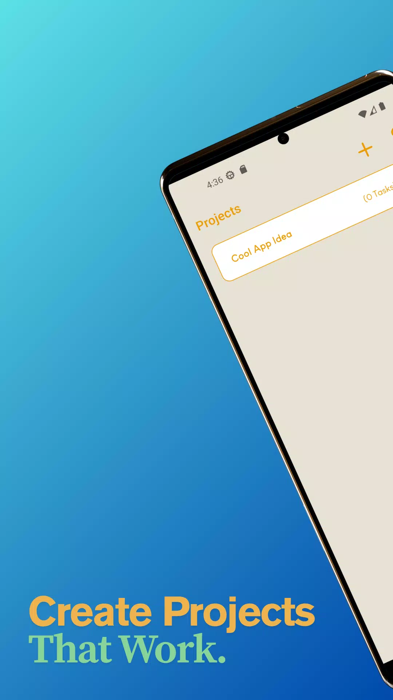
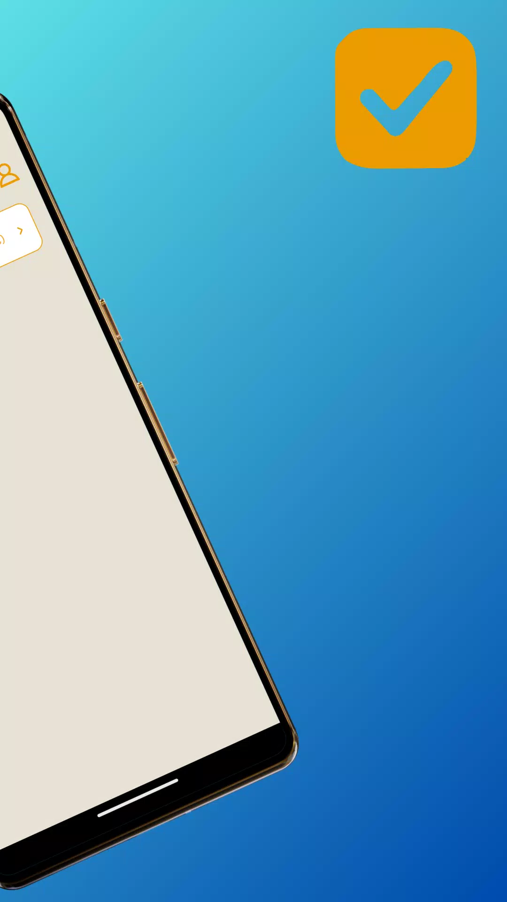
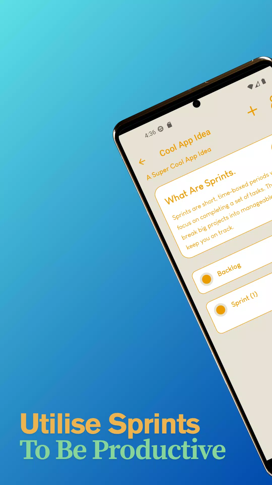
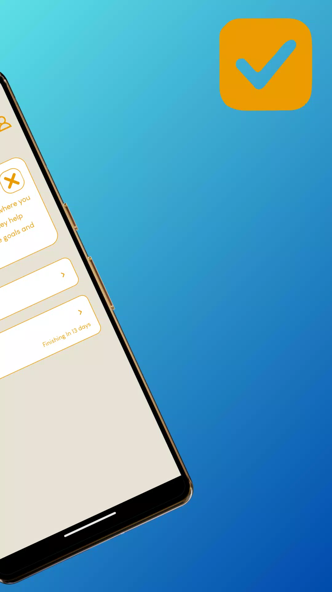
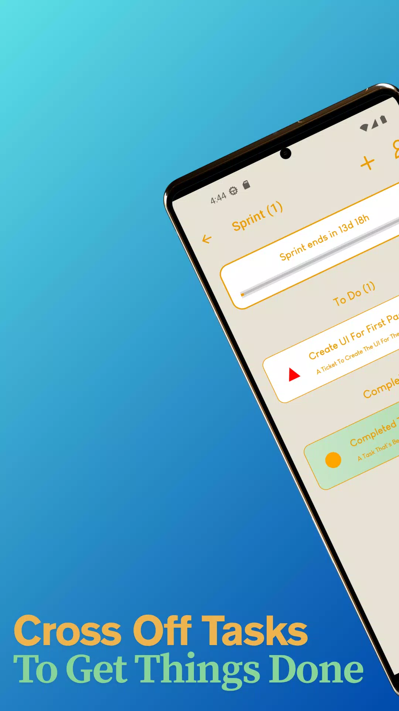
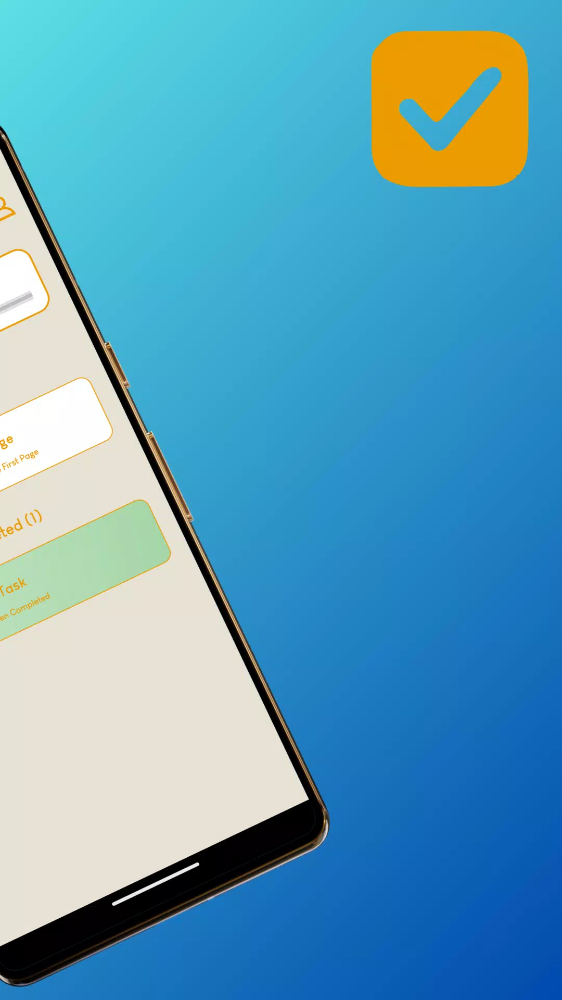

## Looking Back at SLAPP!: A Solo Agile & Productivity App Built in .NET MAUI

One of my earlier projects was **SLAPP!**, a lightweight, solo-focused agile project management and productivity app built with **.NET MAUI**. While SLAPP! is now retired, it remains a project I learned a great deal from, both in cross-platform mobile development and in designing tools for individual focus.

### What SLAPP! Was All About

Most agile project management tools are built around large teams, complex boards, and endless notifications. I wanted the opposite: a clean, distraction-free space where one person could take a big idea, break it down into manageable steps, and actually finish it.

SLAPP! was designed specifically for solo productivity, no team required. Whether someone was organizing personal goals, side projects, or structured agile sprints, the app gave them a simple framework to stay organized and keep momentum going.

### Key Features

- **Projects, Sprints, and Tasks:** Users could quickly create projects, organize work into focused sprints, and break those sprints down into clear, actionable tasks.
- **Deadlines & Prioritization:** Built-in deadline tracking and task prioritization helped highlight what mattered most right now, reducing overwhelm.
- **Visual Sprint Progress:** A straightforward visual progress tracker made it easy to see how close a sprint was to completion at a glance.
- **Built for One:** Everything was tailored around individual workflows, fast to set up, simple to maintain, and focused on execution rather than ceremony.

### Building It with .NET MAUI

Developing SLAPP! in **.NET MAUI** was a great exercise in building a practical, responsive productivity experience from the ground up. It reinforced how much value there is in keeping mobile interfaces clean, local-first, and fast, lessons that directly shaped how I approach building apps today.

Even though SLAPP! has now been retired, it served its purpose well: helping people turn planning into steady, measurable progress and giving me the foundation to keep building useful tools.

### App Store Screenshots

  

    
  

  

    
  

  

    
  

  

    
  

  

    
  

  

    
  

